<div align="center">

# ARTEX PM v0.5 · ArtexPM

AI 自主渗透测试系统（Go 后端 + Next.js 前端）

**二次开发分支 · Secondary Development Fork**

[本仓库](https://github.com/V1ll-V/ArtexPM) · [上游项目](https://github.com/Autumn-27/ARTEX)

</div>

---

## 关于本仓库（先读）

- 本仓库是 [ARTEX](https://github.com/Autumn-27/ARTEX) 的**二次开发分支**，不是上游官方仓库；上游最后版本以源码备份形式提供，原有 Docker 镜像 / Release 链路已失效。
- 本分支相对上游的主要改动：
  1. 新增**人工复核（误报 / 夸大判定）**：人工审查后可发起带条件的复核，Agent 只给建议，最终由人确认；结论进入漏洞详情与导出报告。
  2. Dockerfile 去掉 `# syntax=docker/dockerfile:1`，避免网络受限时 `docker build` 卡在 Docker Hub 前端镜像拉取；`TARGETARCH` 默认 `amd64`。
  3. README 按本分支的构建/升级方式调整；人工复核说明见下文。
  4. `install.sh` / `update.sh` 的 Docker 模式改为**本地构建镜像**；只有显式把 tag 改成非 `local` 时才会拉取上游镜像（且会二次确认）。
  5. 新增完整的**候选验收与可靠报告流程**，配套有界任务收尾、人工决定保护和统一启用检查，详见下方更新说明。
  6. **v0.5.0** 新增独立的 CTF 解题、附件与执行证据、WP、Flag 提交交接和人工确认完成流程；通用任务执行与可选验收开关解耦。
- **不要使用上游的「页面一键更新 / 预编译 Releases / `docker compose pull`」**：它们会拉取上游官方二进制，覆盖本分支的改动。本分支请用下方「快速开始（本分支）」的本地构建流程。
- 开源协议仍为 **AGPL-3.0**；二次开发、分发与网络提供服务时需遵守原协议。

---

## CTF 解题、独立执行与 WP

新建任务可选择“CTF 解题”和 Web / Pwn / RE / 自动分析题型；Web 与普通渗透任务均可使用相同的附件管理。上传后可指定主程序、libc、Loader、源码或输入文件，查看 SHA-256 和静态识别结果，并解压 ZIP。附件会正式绑定任务，详情页的“附件与产物”支持补充、下载和完整性检查。单文件上限 64 MiB，每次上传请求上限 128 MiB，任务附件总量上限 256 MiB；压缩包展开另有数量和大小限制。

Planner、Goals 和 MainAgent 读取当前附件清单，Worker 按意图固定输入快照，续跑保留原版本。附件与快照随原有任务目录归档恢复。旧版对话上传入口继续兼容；新建任务不再依赖将附件绝对路径写入描述。

CTF 任务的 Bash、文件操作和专用分析工具通过独立 `ctf-runner` 执行，工具镜像包含：
- **Pwn / 二进制**：GDB、pwntools、ROPgadget、ropper、one_gadget、pwninit、seccomp-tools、patchelf、checksec、file、binutils。
- **逆向工程**：Ghidra (12.1.4 Headless)、radare2、angr / claripy、Z3、Unicorn、Keystone、QEMU user、UPX。
- **密码学 / 数学**：PyCryptodome、gmpy2、sympy、numpy、Pillow。
- **取证与隐写**：binwalk、tshark、exiftool、steghide、7z、foremost。

应用与工具容器不挂载 Docker socket；只有执行器控制 Docker。每个任务/意图使用独立工作卷，原始附件只读，工具容器使用非 root 用户、只读根文件系统、3 GiB 内存、2 CPU、256 进程和最多 300 秒命令超时。命令超时通过容器内 `timeout -k 3` 限时，仅终止当前命令进程组并返回退出码 124，**不销毁工具容器**，临时目录与工作区文件完整保留。工具状态卡片会实际执行命令、导入 Python 模块并显示版本（共 33 项就绪状态）。现有任务执行及验收启用条件继续适用；CTF 模式缺省关闭资产覆盖度展示。

在 `data/ctf-preview.env` 或系统环境中可通过 `ARTEX_CTF_FLAG_PREFIXES` 自定义全局比赛 Flag 前缀（如 `hgame,DASCTF,moectf,geek` 等，逗号分隔），内置已覆盖 `flag{`、`ctf{` 及 `*ctf{`。系统在输出文本及 Base64 / Hex 编码内容中均会自动捕获并解码登记候选 Flag。

遇到标准 UPX 壳时，可在 CTF 的 Bash 中用 `upx -t "$input"` 检查附件，再用 `upx -d -o /work/unpacked "$input"` 把解包结果写入工作目录。`$input` 为附件清单中的路径。已创建的意图容器继续使用创建时的镜像，新意图会使用更新后的工具镜像。

命令、退出码、输出摘要、完整日志摘要及求解脚本会保留为执行证据。输出中匹配的 Flag 仅登记为候选，用户在任务的“解题报告（WP）”页确认后，才能作为目标完成依据；也可否定并撤销确认。更新附件会使旧输入的候选过期。WP 按已有事实、真实命令、日志和脚本生成，可复制或下载 Markdown；未确认答案时明确标为阶段报告，不会补造成功步骤。归档格式 5 保存执行与候选记录，文件包保存附件、日志、脚本及 WP，并兼容恢复格式 1–4。

CTF 使用专用的目标拆解、规划、执行和交互提示词，不套用通用渗透任务的覆盖率、资产写回、漏洞报告及“空 frontier 必须继续派活”要求。当前输入一旦产生候选 Flag，自动规划和新意图领取进入“等待提交验证”；执行中的模型会在下一次请求边界改用本地交接说明，保留已返回的日志和脚本，不再为总结或 WP 请求模型。已发出的请求或命令可能完成，但不会因此继续启动新的探测。用户可直接复制 Flag 提交题目平台，再记录正确或否定；否定全部待确认候选后自动解题可继续，人工暂停仍然保留。相同输入下已否定或已确认的答案不会因再次出现在输出中而自动重复登记。通用任务沿用原有提示词、规划、验收和有界收尾流程。

平台验证正确后，单题可点击“验证正确并完成任务”，将答案确认、完成状态和完成时间一起提交，停止剩余自动意图；无需再请求模型进行目标验收。尚未继续执行的子目标记为放弃，不伪造达成。多 Flag 或其他交付未完成时可选择“仅确认，保留其他目标”。旧版已确认但仍运行的题目可点击“完成解题任务”。撤销答案确认或更新输入会撤销相应的人工完成结果，重新打开并暂停任务供用户继续。通用任务的完成门禁保持原样。

Web 题可使用 `ctf_http` 在同一独立容器中发送 HTTP/HTTPS 请求，支持查询参数、表单、请求头、原始正文及意图内 Cookie。响应头、正文、状态码和最终 URL 会留存为执行证据，真实输出中的 Flag 进入候选流程。默认不跟随重定向，显式允许后最多跟随 3 次；正文上限 64 KiB、响应上限 8 MiB、请求超时最多 120 秒。连接失败时不会复用上次响应作为新证据。模型可以用 `ctf_status` 查询当前输入版本、执行次数及答案状态，规划和续跑上下文也会带入最新候选，减少重复求解或重复登记。

远程靶机探测与交互：遇到远程靶机题目（如 Pwn、Web 或带 Proof-of-Work 校验的比赛靶机）时，Agent 可通过 `ctf_probe_target` 工具（或在 Bash 中直接执行 `ctf-probe`）快速探测目标连通性、RTT 延迟、初始 Banner、TLS 支持与 HTTP 状态，并自动识别 PoW 防爆破挑战（如 sha256/md5/hashcash）与交互式菜单，给出即用型 pwntools (`remote('host', port)`) / nc 连线建议。对于需要多轮命令与输入交互的题目，可通过 `ctf_session_start` 建立持续的 PTY 伪终端会话，使用 `ctf_session_send` 连续投递多轮输入，使用 `ctf_session_read` 增量长轮询读取回显（流式输出中的 Flag 同样会自动识别提取并登记为候选），结束后调用 `ctf_session_close` 优雅关闭。耗时较长的大任务亦可通过 `ctf_run_background` 异步后台运行并用 `ctf_job_status` 轮询进度，避免单次命令超时限制。

WP 页面在可见时每 5 秒自动更新，切换到后台后暂停刷新。页面分别展示“正在解题”“等待确认答案”“答案已确认”和任务停止状态，标出旧输入版本与截断输出；答案确认状态与任务是否完成分别展示。确认操作和切换任务时会取消旧的刷新请求，防止旧数据覆盖新状态。

上传草稿由服务端生成批次 ID；`POST /api/gc?ttl=86400` 可清理超过一天的未绑定草稿，数据库引用的待绑定批次受到保护。文件与版本清单位于任务目录，数据库保存任务模式、题型和绑定批次，便于沿用已有归档文件事务。

CTF 预览使用应用镜像 `autumn27/artex:v0.5.0`、执行器镜像 `autumn27/artex-ctf-runner:20261109` 和工具镜像 `autumn27/artex-ctf-tools:20261109`。`docker-compose.ctf-preview.yml` 使用项目名 `artex-ctf-preview`，访问 `http://localhost:8789`；它有独立数据库、数据卷、技能卷和执行器状态卷，首次进入需设置密码及模型。当前机器的预览配置保存在不纳入 Git 的 `data/ctf-preview.env`，包含数据库密码和至少 24 字符的随机 `ARTEX_CTF_RUNNER_TOKEN`。应用通过 `ARTEX_CTF_RUNNER_URL` 和相同令牌连接内部执行器；执行器不对宿主机发布端口。可用下列命令管理：

```powershell
docker compose --env-file data/ctf-preview.env -p artex-ctf-preview -f docker-compose.ctf-preview.yml up -d --pull never
docker compose --env-file data/ctf-preview.env -p artex-ctf-preview -f docker-compose.ctf-preview.yml stop
```

本地构建时先按下文生成嵌入前端的应用二进制，再构建应用镜像；执行器单独编译为 Linux amd64 二进制：

```sh
docker build -f Dockerfile.ctf-tools -t autumn27/artex-ctf-tools:20261109 .
CGO_ENABLED=0 GOOS=linux GOARCH=amd64 go build -o dist/amd64/ctf-runner ./cmd/ctf-runner
docker build -f Dockerfile.ctf-runner -t autumn27/artex-ctf-runner:20261109 .
docker build -t autumn27/artex:v0.5.0 .
```

Windows 下可在 `web` 中使用 `$env:NEXT_EXPORT='1'; npm run build -- --webpack` 完成静态构建。`ctf_decompile` 按二进制 SHA-256 在容器 `/tmp/ghidra_<hash>` 建立持久工程，二次反编译自动启用 `-noanalysis` 跳过重复导入与全量分析。真实样例集成测试为 `ctf/TestPwnREExecutionEvidenceWPAndArchive` 与跨领域基准套件 `ctf/TestCTFBenchmarkSuite`（及 12 题端到端基准脚本 `benchmarks/run_benchmark.py`，覆盖 Crypto / Reverse / Pwn / Forensics / Web），需设置测试专用的 `ARTEX_PG_DSN` 和 `ARTEX_CTF_DOCKER_TEST=1`。推荐通过 `ARTEX_CTF_TEST_RUNNER_URL` / `ARTEX_CTF_TEST_RUNNER_TOKEN` 连接单独执行器，使测试进程无需 Docker socket。测试会编译本地合成题目，覆盖 GDB 断点、Ghidra 反编译、pwntools 求解、angr/Claripy、候选确认、WP 缓存、归档恢复和超时续跑。

Go 数据库测试使用专用空库。重复运行多包测试时应按包隔离数据库，避免全局队列、企业范围和资产归属记录相互影响；迁移测试需要默认 `public` schema，调用记录相关测试还需要初始化 `llm_records` / `llm_usage` 运行表。

## 授权渗透任务模板

提供侦察、漏洞发现、定向复现/修复复测、全流程交付四类授权环境模板，正文和使用说明见 [templates/](templates/README.md)。应用模板后填写授权范围、账号权限、测试窗口与预算，并配置实际范围规则。模板按覆盖与交付定义完成条件，不强求发现漏洞；正式漏洞结论仍需独立验收。已有任务不会随模板更新回填修改。

## 2026-11-02：报告与调用开销优化

候选尚未通过验收时，详情页自动提供**候选材料报告**，可复制或导出 Markdown，列明原始材料、未支持主张和待补证据；这不是正式漏洞报告，不编造完整 PoC。当前验收有效后仍由报告队列自动撰写正式详细报告。Reporter 明确表示缺证据时不再对相同输入自动重试三次。

若调用量偏高，请在 Agent 设置配置单次轮数：本机受控配置为 Worker 40 轮、Planner 12 轮，原配置已备份；上限只约束单次执行，达到上限按原收尾机制保存进度，不视为漏洞确认。输入 token 中的缓存读取与新输入应分别理解，不直接等同账单金额。

## v0.4 更新：候选验收与报告流程（2026-10-28）

v0.4 版本将界面名称统一为 **ARTEX PM v0.4**，原登录用户名 `ARTEX` 和已有数据保持兼容。本次更新完善了漏洞发现、证据验收和报告交付流程，减少未经充分验证的结论进入正式报告，并让后续验证更有依据。

- **漏洞发现先登记、再验收**：新发现先保存为候选，经过独立验收后，才能作为确认漏洞生成正式报告或用于判断任务完成。
- **验收意见帮助继续验证**：缺失的证据、尚未获得支持的主张会反馈给任务规划者，便于继续补充对照、核实影响范围，而不是停留在初步现象上。
- **报告更清楚地说明成立条件**：报告以验收支持的范围、前提和等级为依据；没有独立确认等级时明确标注，减少将候选的高危判断直接当成最终结论。
- **人工复核持续生效**：人工确认或否定后，自动验收不会覆盖人工决定，只有人工主动清除后才交回自动判断。复核结论与处理状态分别保留，避免将“已忽略”“已处理”等状态误当成真实性判断。
- **补充证据后重新检查结论**：证据或主张发生变化时，原结论会重新接受有效性检查，对应的旧报告会标为失效，避免继续引用已经不适用的结论。
- **重复验证集中在同一条发现中**：可以向已有发现追加验证和证据，减少重复登记；重复提交相同材料不会反复触发验收，也支持对已保存证据重新发起验收。
- **任务结束时更完整地保存成果**：目标达成后停止分派新工作，为正在执行的工作保留有限的收尾时间，减少结果遗漏；收尾不会延长原定截止时间。
- **中断后更可靠地接续处理**：服务恢复后可继续处理待办验收和报告，降低遗漏、重复生成以及旧执行覆盖新结果的风险。
- **列表、详情和导出的结论保持一致**：候选、有效确认、已否定和已过期的结论有清晰标识；导出保留验收范围、适用前提及历史报告状态，任务汇总区分有效确认与其他发现。
- **归档保留完整复核历史**：归档与恢复保留候选主张、人工意见、验收记录和报告历史；旧版本历史记录仍可查看，但不会直接视为通过了新流程验收。
- **可选的自动验收入口**：在“系统 → 候选验收”查看配置和验收／报告队列，并直接选择验收模型与漏洞报告模型。默认复用任务或系统模型，无需单独购买多套模型。开关默认关闭，仅控制漏洞候选的自动验收与报告；任务启动、继续、目标证据判定和有界收尾独立运行。报告模型未就绪时报告等待，不阻止任务求解或候选验收。
- **改善兼容性与升级体验**：修复 Windows 下 HTTP 证据保存失败、部分文件路径兼容问题，并补全任务规划中的企业关联范围信息。升级时保留自定义配置，对需要核对的内容明确提示。

升级时请使用同一版本的前后端。设置默认模型或任务模型后即可执行任务；如需自动漏洞验收与报告，再进入“系统 → 候选验收”检查并按需启用。目标完成仍须通过证据判定，CTF Flag 仍须用户确认；停用可选自动化不会把未验证候选直接变成确认漏洞。旧版 Reporter 的“登记后直接写报告”触发器应先备份并停用，再重试配置迁移。独立验收有助于减少误报，但不能保证发现一定真实，也不能保证覆盖所有漏洞。

---

## 截图预览

> 以下多数界面示意截自上游版本；候选验收检查页为本分支 ARTEX PM v0.4 的实际截图。

**候选验收与任务收尾：启用检查（配置待复核示例）**

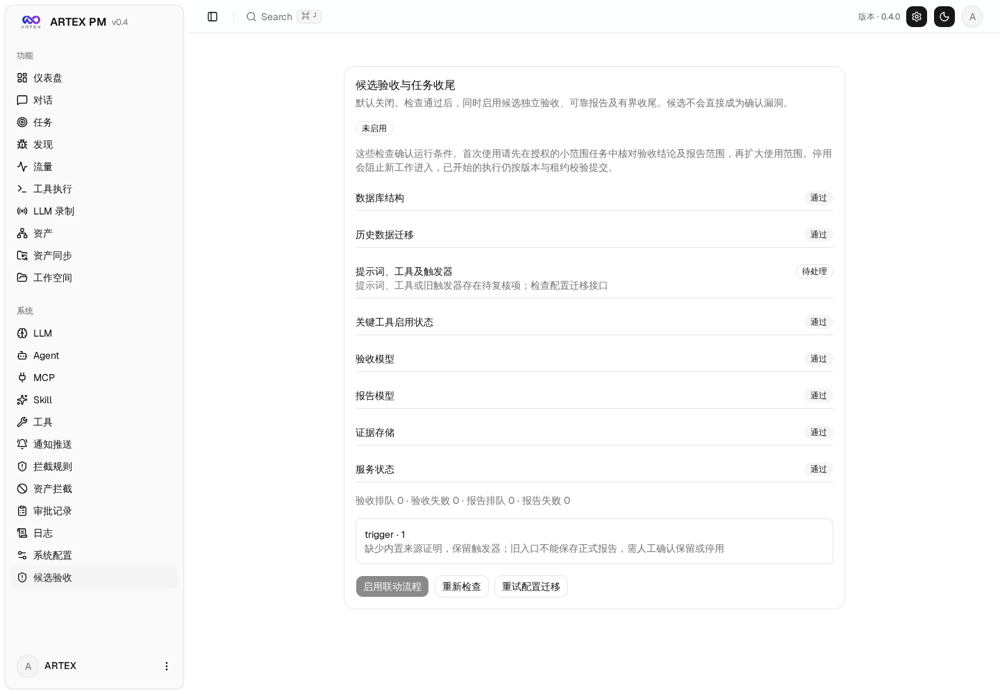

| 仪表盘（总览 / Token 消耗 / 活动流） | 任务列表 |
| :---: | :---: |
| 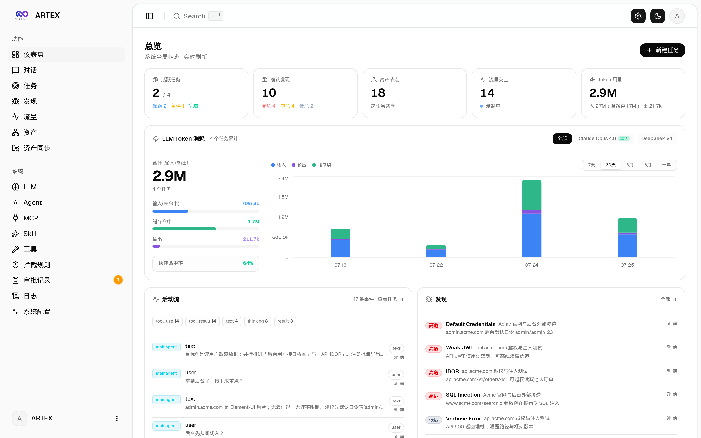 | 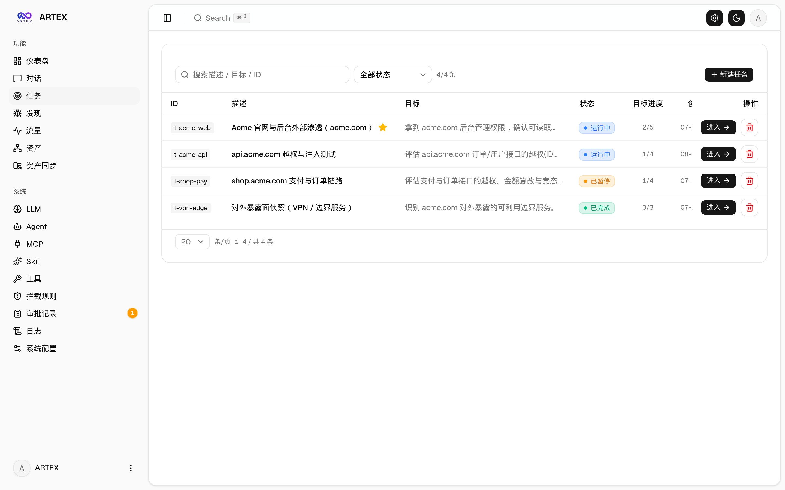 |

| 任务 · 执行过程（会话 / 工具调用） | 探索链路 |
| :---: | :---: |
| 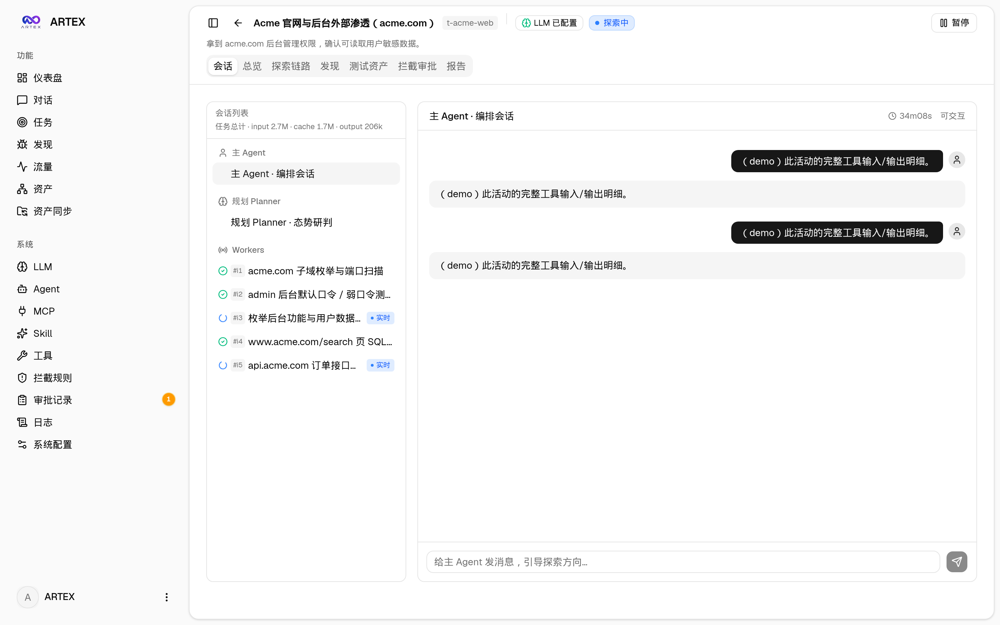 | 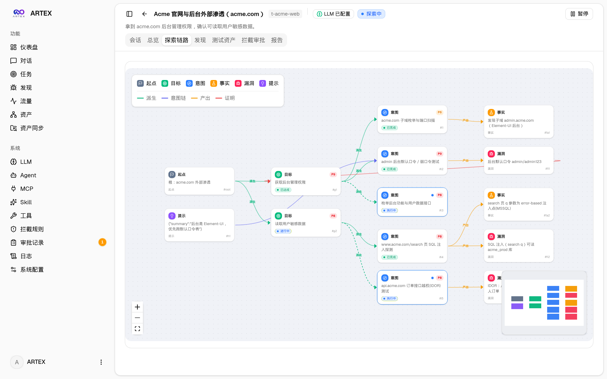 |

| 发现 | 资产 |
| :---: | :---: |
| 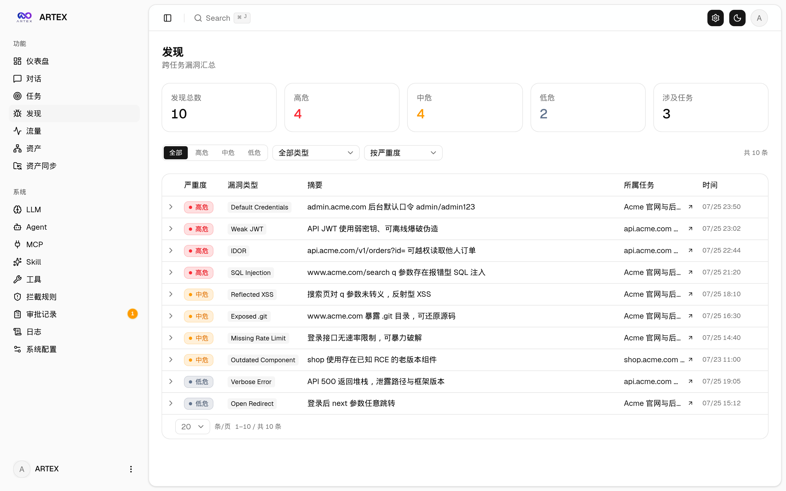 | 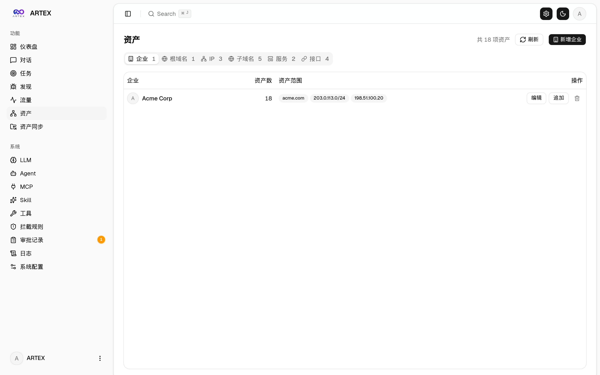 |

| 资产覆盖图（力导向布局 · 已测高亮 · 节点折叠展开） |
| :---: |
| 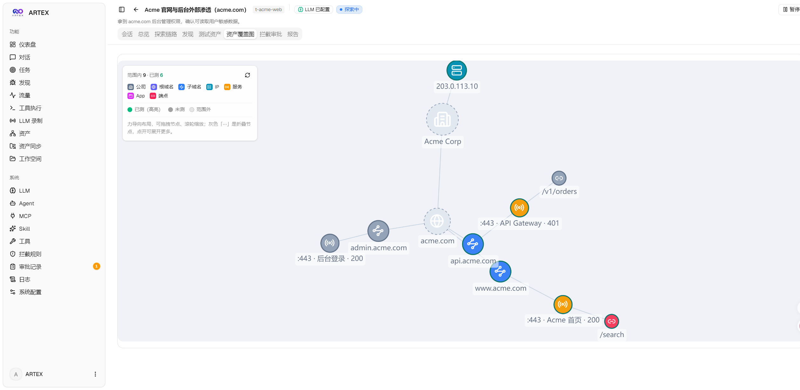 |

| 流量录制 | 人在环路对话 |
| :---: | :---: |
| 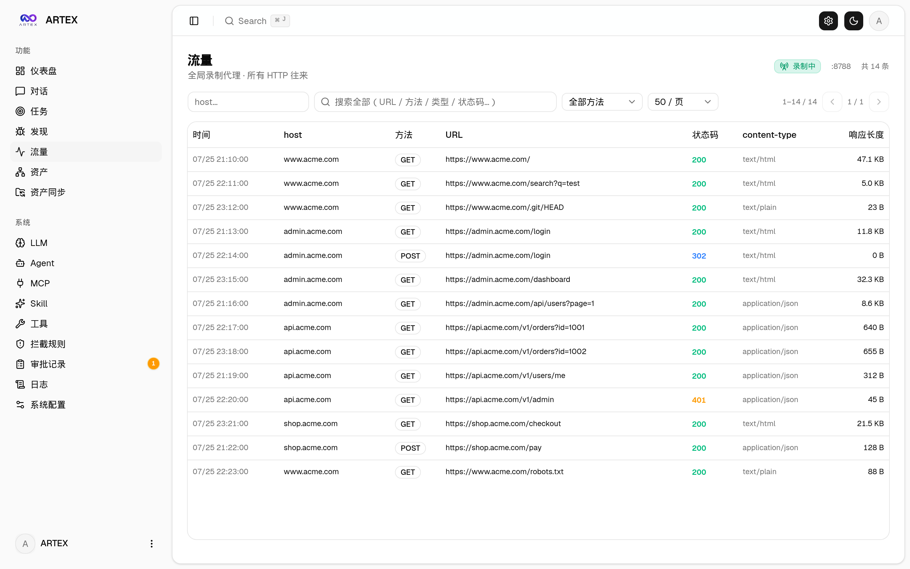 | 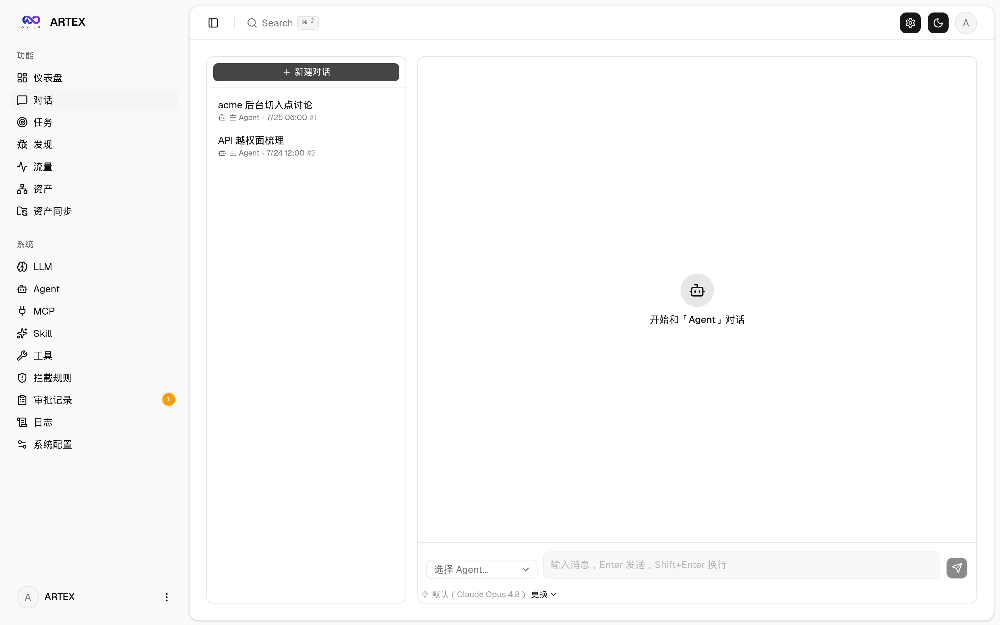 |

| Agent 管理 | LLM 配置 |
| :---: | :---: |
| 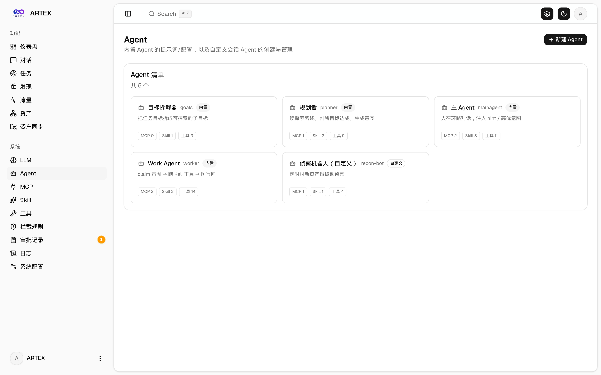 | 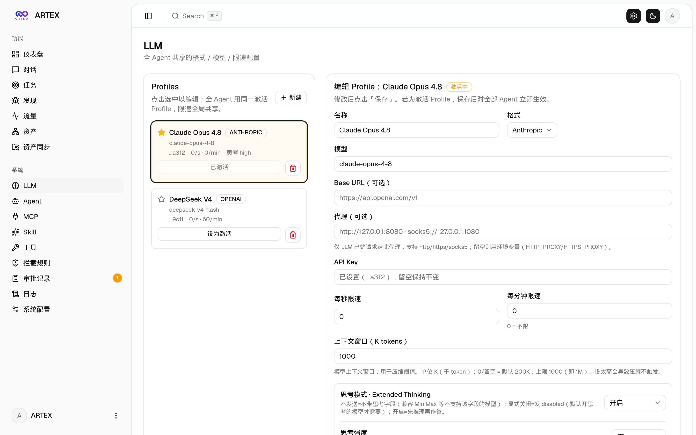 |

| 拦截审批 | 后端日志 |
| :---: | :---: |
| 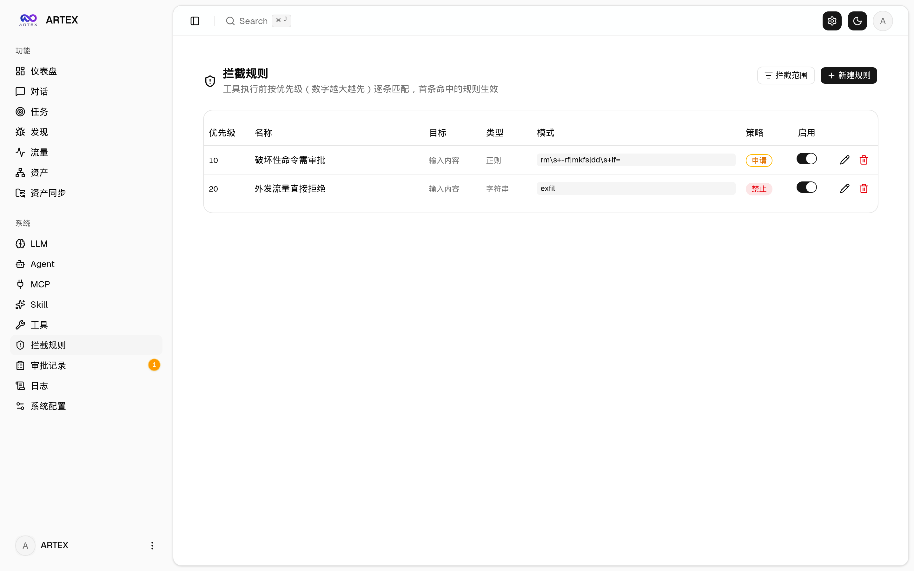 | 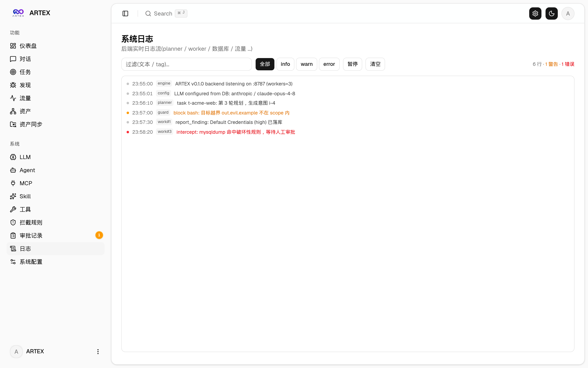 |


---

## 审批记录详情

全局「审批记录」、任务内「拦截审批」及对话中的审批卡片均支持展开查看详情。展示结构参考
[AegisHook 的审批详情组件](https://github.com/RuoJi6/AegisHook/blob/main/web/src/components/CallDetail.vue)，沿用 ARTEX 的组件和主题：


## 资产同步（ScopeSentry）

支持从 [ScopeSentry](https://github.com/Autumn-27/ScopeSentry) 直接同步资产数据，免去重复收集：

- 在「**资产同步**」页填 ScopeSentry 的地址与 API Key，接入数据源；
- 按**项目**或**任务**维度选择要同步的目标与资产类型（域名 / 子域 / IP / 端口 / 站点 / 端点…）；
- 一键导入并按公司资产范围归并，直接进入 ARTEX 的资产图供 agent 探索使用。

---

## 快速开始（本分支）

> 本分支推荐用**本地构建**：前端静态导出 → 编译内嵌单二进制 → 构建运行镜像。上游的预编译镜像/Releases 不包含本分支改动。

### 前提

- Docker + Docker Compose
- Go 1.26+（仅构建二进制用；也可以在 `golang:1.26` 容器里编译）
- Node.js 20+ 与 npm（构建前端）

### 1. 配置

```bash
cp .env.example .env
```

`.env` 至少填 `POSTGRES_PASSWORD`；并把 `ARTEX_TAG` 改成 `local`，与下面构建的镜像 tag 保持一致：

```dotenv
ARTEX_TAG=local
POSTGRES_PASSWORD=change-me
```

### 2. 构建前端与单二进制

```bash
# 前端静态导出
cd web && npm ci && npm run build:static && cd ..

# 拷进内嵌目录
rm -rf server/webui/dist && cp -r web/out server/webui/dist

# 编译 Linux 单二进制（-tags embedui 才会内嵌前端）
CGO_ENABLED=0 GOOS=linux GOARCH=amd64 \
  go build -tags embedui -o dist/amd64/artex ./cmd/artex
```

> Windows PowerShell 下 `npm run build:static` 的 `NEXT_EXPORT=1` 写法不生效，改用：
> `$env:NEXT_EXPORT='1'; npx next build`。
> 也可以在 Go 容器里编译，避免本机装 Go：
> `docker run --rm -v "$PWD:/src" -w /src golang:1.26 sh -c 'CGO_ENABLED=0 GOOS=linux GOARCH=amd64 go build -tags embedui -o dist/amd64/artex ./cmd/artex'`

### 3. 构建镜像并启动

```bash
docker build -t autumn27/artex:local .
docker compose up -d
# → http://localhost:8787（首次进入 /setup 设置管理员密码）
```

- 数据库迁移在 `artex` 启动时幂等执行；升级前建议备份 PostgreSQL 与 `./data`。
- 配置默认模型或任务模型后即可运行任务。“系统 → 候选验收”中的自动漏洞验收与报告默认关闭，可按需配置并启用，不影响任务执行。
- `docker build` 需要能访问 Debian / NodeSource / Playwright 的下载源。网络受限时，可以给构建传代理：
  `docker build --build-arg HTTP_PROXY=http://host.docker.internal:7890 --build-arg HTTPS_PROXY=http://host.docker.internal:7890 -t autumn27/artex:local .`

### 将 v0.5 替换到已有 Docker 业务环境

升级使用原来的 Compose 项目、`.env`、`pgdata` 卷以及 `./data`、`./skills`。**不要删除数据库卷，也不要使用 `docker compose down -v`。** 更改项目名称或另开目录会连到另一套数据。

1. 先按上面的步骤构建最新前端与内嵌二进制，编译时加 `-ldflags '-X main.version=v0.5.0'`，然后构建 `autumn27/artex:v0.5.0`。本地 tag 不表示已发布 Docker Hub 镜像，勿执行 `pull`。
2. 确认没有任务正在执行后，停止应用、备份数据库、数据目录和 `.env`，保留旧镜像。以下为本项目的 PowerShell 示例，其他安装需把项目名改为自己原来的名称：

```powershell
$backupDir = Join-Path $HOME ('artex-backups/' + (Get-Date -Format 'yyyyMMdd-HHmmss'))
New-Item -ItemType Directory -Path $backupDir -Force | Out-Null
docker tag autumn27/artex:local autumn27/artex:pre-v040
# 停止应用后再做一致性备份，数据库保持运行。
docker compose -p artex_last_version-main stop -t 120 artex
docker compose -p artex_last_version-main exec -T postgres sh -c 'pg_dump -U "$POSTGRES_USER" -d "$POSTGRES_DB" -Fc -f /tmp/before-v040.dump'
if ($LASTEXITCODE -ne 0) { throw '数据库备份失败，停止升级' }
docker cp artex_last_version-main-postgres-1:/tmp/before-v040.dump "$backupDir/database.dump"
Copy-Item -LiteralPath .env -Destination "$backupDir/.env"
Copy-Item -LiteralPath ./data -Destination "$backupDir/data" -Recurse
Copy-Item -LiteralPath ./skills -Destination "$backupDir/skills" -Recurse
docker cp artex_last_version-main-artex-1:/app/jwt.key "$backupDir/jwt.key"
```

3. 将原 `.env` 中的 `ARTEX_TAG` 改为 `v0.5.0`，其他密码和模型配置保持原值。只重建应用：

```powershell
docker compose -p artex_last_version-main up -d --no-deps --pull never artex
Invoke-RestMethod http://localhost:8787/api/health
```

4. 打开 [控制台](http://localhost:8787)，应看到 **ARTEX PM v0.5**。使用原密码登录，检查原任务和发现。配置可用模型后即可执行任务；自动漏洞验收与报告可在“系统 → 候选验收”按需启用。重建容器可能需要重新登录，用户名仍为 `ARTEX`。

备份含密码、签名密钥及业务证据，请保存在仓库之外。升级后的数据库不能保证兼容旧程序，**回退需同时恢复升级前的数据库与 `data` 快照，并恢复旧 `.env`、旧镜像；仅切换镜像不算完整回退**。先停应用，在独立库验证恢复备份后再切回，保留当前数据另作快照。

### 网络受限时的本地增量构建

已有包含运行依赖的本地镜像时，可复用其工具层，替换刚编译的程序和启动脚本；不会下载 apt/npm 依赖：

```powershell
docker tag autumn27/artex:local autumn27/artex:pre-v040
docker build -f Dockerfile.incremental --build-arg ARTEX_BASE_IMAGE=autumn27/artex:pre-v040 -t autumn27/artex:v0.5.0 .
```

必须先完成前端导出和 Linux `embedui` 二进制编译。该方式不更新旧镜像的系统依赖，完整环境更新仍使用主 `Dockerfile`。增量镜像仅供本地使用；上传源码到 Git 不会把镜像上传到镜像仓库。

---

## 其他安装方式（含上游参考）

> 以下保留 ARTEX 的安装/升级方式作参考。注意：`./install.sh` / `./update.sh` 的 Docker 模式已在本分支改为**本地构建镜像**；`docker compose pull`、Releases 等仍指向上游。本分支请优先使用上面的「快速开始（本分支）」。

> 依赖数据库 **PostgreSQL**；探索需配置 **LLM**（`ANTHROPIC_API_KEY` 或 `OPENAI_API_KEY`，也可在 UI 里配）。

### 方式一：一键安装脚本（本分支 Docker 模式已适配）

```bash
git clone https://github.com/V1ll-V/ArtexPM.git
cd ArtexPM
./install.sh
```

> Docker 模式会先把 `.env` 的 `ARTEX_TAG` 设为 `local`，再本地 `docker build`；找不到 `dist/<arch>/artex` 时会尝试从源码构建，或提示你先构建二进制，不会静默拉取上游镜像。

脚本会：检测 / 自动安装 Docker → 让你选 **① 全部 Docker** 或 **② 本地编译运行**：

- **① 全部 Docker**：填一个 Postgres 密码（可回车随机）→ 自动写 `.env` → 本地构建镜像 → `docker compose up -d`。
- **② 本地运行**：选数据库（连已有 / 用 Docker 起一个）→ 生成 `config.json` → `go` 编译内嵌单二进制 → 启动。

装好后打开 **http://localhost:8787**（首次进入 `/setup` 设置管理员密码）。

### 方式二：Docker Compose（手动，拉取上游镜像）

```bash
git clone https://github.com/Autumn-27/ARTEX.git
cd ARTEX
cp .env.example .env          # 填 POSTGRES_PASSWORD、可选 ANTHROPIC_API_KEY
docker compose up -d          # 拉取 autumn27/artex 镜像 + postgres
# → http://localhost:8787
```

镜像已含常用工具（ripgrep/curl/vim/npm/nmap…）；`./skills` 与 `./data` 以绑定挂载持久化。

远程 MCP 可在系统设置中选择 `http`（Streamable HTTP）或 `sse`（旧版 SSE）。
旧版 SSE 服务通常使用 `GET /sse` 建立事件流，再通过服务返回的
`/message?sessionId=...` 接收 JSON-RPC 请求；配置时将 URL 填为 `/sse`，请求头按
`Authorization=Bearer <token>` 填写。

### 方式三：下载预编译二进制（Releases）

到 [Releases](https://github.com/Autumn-27/ARTEX/releases) 下载对应平台的 zip，解压后得到 `artex` + `start.sh`（Windows 为 `start.bat`）+ `skills/` + `config.example.json`：

```bash
cp config.example.json config.json   # 填好 database 连接
./start.sh                           # → http://localhost:8787
```

> 请用 `start.sh` / `start.bat` 启动，而不是直接跑 `./artex`。它是个守护脚本：程序退出后按退出码决定是否重新拉起，**上游的页面一键更新靠它完成换装（本分支不推荐该功能，见下文）**。直接运行 `./artex` 时更新完就不会被拉起了。
> 后台常驻：`nohup ./start.sh >artex.log 2>&1 &`。

### 方式四：从源码编译单二进制

```bash
# 1) 前端静态导出
cd web && npm ci && npm run build:static && cd ..
# 2) 拷进内嵌目录
cp -r web/out server/webui/dist
# 3) 编译（-tags embedui 才内嵌前端）
CGO_ENABLED=0 go build -tags embedui -o artex ./cmd/artex
./start.sh
```

### 方式五：构建跨平台 Release 压缩包

`build.sh` 会先构建并嵌入前端，再使用 Go linker 去除调试信息，并将发布文件压缩为 zip。Release 模式默认生成 Linux amd64/arm64、macOS amd64/arm64 和 Windows amd64 的 zip 包：

```bash
./build.sh --release
# 产物：dist/artex-0.3.3-*.zip
```

UPX 自解压二进制可能与部分 Linux 内核、虚拟化环境或安全策略不兼容，因此默认不启用。可用 `ARTEX_TARGETS` 自定义目标；确认目标运行环境兼容时，可显式传入 `--upx` 进一步缩小二进制：

```bash
ARTEX_TARGETS=linux/amd64,windows/amd64 ./build.sh --release
./build.sh --target linux/amd64 --upx
```

---

## 更新升级（本分支）

> ⚠️ **本分支不要使用页面「一键更新」**：它从上游 GitHub Release 下载官方二进制，会覆盖本分支的人工复核等改动，甚至造成新代码与数据库结构不匹配。
>
> 本分支升级流程：
> ```bash
> git pull                      # 或 rebase 到上游
> # 重新执行「快速开始（本分支）」的 2、3 步
> docker compose up -d artex
> ```
> 数据库迁移仍由新二进制启动时幂等执行；升级前请备份 PostgreSQL 与 `./data`。
>
> 也可以运行 `./update.sh` 选择「Docker 更新」：本分支会本地重建镜像（`ARTEX_TAG=local`），不会拉取上游。
>
> 下面保留上游的更新说明，仅作参考。

> 升级只换程序、不动数据：Postgres 数据卷 `pgdata`、`./data`（jwt.key / SQLite 等）、`./skills` 都会保留。**数据库迁移无需手动执行**——`artex` 每次启动会幂等重跑 `schema.sql`（含 `ADD COLUMN` / `CREATE INDEX IF NOT EXISTS`），即“重启即迁移”。升级前仍建议先备份 `./data` 与数据库。

### 方式一：页面一键更新（上游功能，本分支不推荐）

在 **系统配置** 页（侧边栏「系统配置」→ `/system/settings`）的**版本与更新**卡片里，可以直接检查并安装新版本，无需登录服务器。

点「更新」后：下载当前平台的发布包 → 比对 Release 的 `SHA256SUMS` → 用 `-h` 冒烟测试新二进制 → 暂存为 `artex.new` → 程序退出，由 `start.sh` / `start.bat` 重新拉起并完成换装。页面会自动等到新版本上线后刷新。

- **失败不会留下坏程序**：校验或冒烟不通过就丢弃暂存件、继续跑当前版本；换装后的新版若连续 3 次启动失败，会自动回滚到 `artex.old`（失败的那个留作 `artex.failed` 供排查）。
- **随时可回退**：上一版本保留为 `artex.old`，卡片上有「回滚到上一版本」。注意数据库结构不会回退。
- **更新会中断正在运行的任务**——更新即重启，请在空闲时进行。
- **开发构建不给更新**：版本号是 `dev` 或 `git describe` 带后缀时禁用，避免正式版覆盖掉本地调试的二进制。
- **Docker 下只换程序、不换镜像**：镜像里的 playwright / nmap 等工具链不会跟着升级，且 `docker compose up -d` 重建容器后会退回镜像自带的版本。本分支要连镜像一起升级，请用本地 `docker build -t autumn27/artex:local .`，不要用 `docker compose pull`（会拉上游镜像）。
- 访问 GitHub 需要代理时，在同一页面配置**全局代理**即可，更新链路会走它。更新只从 GitHub 域名下载并强制 HTTPS。

### 方式二：一键更新脚本（本分支 Docker 模式已适配）

```bash
cd ArtexPM
./update.sh
```

脚本先可选 `git pull` 拉取最新代码，再让你选 **① Docker 更新** 或 **② 本地编译更新**（与 `install.sh` 对应）：

- **① Docker**：默认 `ARTEX_TAG=local` → `docker build` 本地重建 → `docker compose up -d`（重启即自动迁移）。只有把 tag 改成非 `local` 时才会 `docker compose pull`，并会二次确认。
- **② 本地**：重建前端静态产物 → 重新编译 `./artex`（完成后重启进程生效）。

### 方式三：Docker Compose（手动，拉取上游镜像）

```bash
cd ARTEX
git pull                       # 更新 compose / 脚本（可选）
# 指定版本：在 .env 设 ARTEX_TAG=v0.2.0；不设则用 latest
docker compose pull artex
docker compose up -d artex     # 换新镜像重启 → 自动迁移 schema
docker image prune -f          # 清理旧镜像（可选）
```

### 方式四：预编译二进制（Releases）

到 [Releases](https://github.com/Autumn-27/ARTEX/releases) 下载新版本 zip，停掉旧进程后覆盖 `artex` 与 `skills/`（保留你的 `config.json` 与 `data/`），重启即可：

```bash
cp -r <解压目录>/skills ./ && cp <解压目录>/artex ./
./start.sh
```

### 方式五：从源码编译

```bash
git pull
cd web && npm ci && npm run build:static && cd ..
cp -r web/out server/webui/dist
CGO_ENABLED=0 go build -tags embedui -o artex ./cmd/artex
# 重启 ./start.sh
```

---

## 配置

**数据库**（`config.json`，或用环境变量 `ARTEX_PG_DSN` 覆盖）：

```json
{
  "database": {
    "host": "127.0.0.1", "port": 5432,
    "user": "artex", "password": "yourpass",
    "dbname": "artex", "sslmode": "disable"
  }
}
```

**LLM**：`export ANTHROPIC_API_KEY=sk-...`（或 `OPENAI_API_KEY`），也可在 UI 的「LLM 配置」页填写。
可选：`ARTEX_LLM_PROVIDER` / `ARTEX_LLM_MODEL` / `ARTEX_LLM_BASE_URL` / `ARTEX_LLM_PROXY`。

**并发**：每个任务的 work agent 数在「系统设置」里配置（默认 3）。

**常用参数**：`./start.sh -addr :8787 -proxy :8788`（`-addr` 前端+API，`-proxy` 流量录制代理）。启动脚本会把参数原样透传给 `artex`。

### 反向代理部署（HTTPS / 只开放 443）

前端和 API/SSE 都由同一个后端端口（默认 `:8787`）提供，实时活动流默认走**同源**地址，因此**无需配置 `NEXT_PUBLIC_SSE_BASE`**，公网只开放 443、把 8787 留在内网即可。

SSE 是长连接 + 持续推送，反代**必须关闭缓冲**，否则浏览器能连上却收不到事件（表现为活动流一直转圈）。Nginx 示例：

```nginx
server {
    listen 443 ssl;
    server_name your.domain.com;
    # ssl_certificate / ssl_certificate_key ...

    location / {
        proxy_pass http://127.0.0.1:8787;
        proxy_set_header Host $host;
        proxy_set_header X-Forwarded-Proto $scheme;

        # SSE 关键项：关缓冲、长超时、HTTP/1.1
        proxy_buffering off;
        proxy_cache off;
        proxy_read_timeout 3600s;
        proxy_http_version 1.1;
        proxy_set_header Connection "";
    }
}
```

> 仅当 SSE 需要走与页面不同的来源（如独立子域）时，才在**构建期**设置 `NEXT_PUBLIC_SSE_BASE`（该变量在 `next build` 时固化进静态包，容器运行时再设无效）。

---


## 开发

### 手动漏洞复测

任务详情的「复测」页签可分页选择本任务的漏洞、查看历次结论和证据，并手动发起复测。启动后保留当前页签，显示转圈图标和「复测中」；确认修复后同步更新漏洞状态。

在漏洞列表每行操作区点击「复测」，或在漏洞详情的「漏洞复测」区域点击「发起复测」，填写可选的修复版本、测试条件或限制，系统会创建独立的复测 Agent 会话，启动后保留当前页面。列表的平铺、按任务分组和资产视图均支持该入口；复测运行时显示转圈图标和「复测中」，需要查看时点击进入对应会话，结束后恢复「复测」。复测无需重新启动原扫描任务，结论分为「仍可复现」「已修复」「无法确认」，每次的结论、证据和会话链接保存在漏洞详情中。

新版后端首次启动会预置可编辑的「漏洞复测」（`retester`）Agent，可在 Agent 管理中配置提示词、LLM、运行预算和工具。默认使用其绑定的 LLM，未绑定则使用全局激活配置。复测会话成功完成且结论为「已修复」时，系统自动将漏洞处置状态改为「已修复」；执行中、失败、停止或其他结论保留原状态。原始证据和报告始终保留。也可在状态下拉菜单中手动选择「已修复」。同一漏洞正在复测时复用已有会话，停止、失败或服务重启后可重新发起。

本版历史记录通过漏洞详情和会话查看，暂未纳入漏洞报告导出或任务归档包，也未自动关联流量包。演示模式只生成明确标注的模拟记录，不请求真实目标。

### 人工复核（误报 / 夸大判定）

人工审查发现漏洞疑似误报或影响被夸大时，可在漏洞详情、发现列表行内或任务详情的「复核与复测」页签发起**复核**。与「修复复测」不同，复核回答的是「这个漏洞是否成立、是否被夸大」，而不是「修复后是否仍可复现」。

- 发起时可填写审查意见/疑点与重点关注项。复核默认**只读证据，不发起新请求**；只有显式勾选「允许按原 PoC 做最小化验证」后，才允许在请求上限、禁止操作和资产范围内做最小验证，并全程走记录代理。
- Agent 结论为「成立 / 误报 / 夸大 / 无法确认」，附置信度、证据与建议（建议严重级、建议状态）。**结论只是建议，系统不会自动修改漏洞状态或严重等级**。
- 如果复核发现原详细报告存在夸大或事实偏差、需要更正，Agent 会额外生成一份**完整的修订后漏洞报告**，显示在复核记录的「修订后报告」折叠区（在「复核证据」下方）。要求与正常漏洞报告一致：漏洞概述、影响与危害（含修订后严重等级）、复现步骤 / PoC、证据、修复建议。它作为建议供人工查看，**不会覆盖原报告**；原报告仍完整保留。
- 人工在详情页的「人工复核」区域确认或改判，可填写备注；选择「误报 / 成立」时可勾选同时更新处置状态，「夸大」时可直接调整严重级。最终判定保存在漏洞上。
- 复核结论会显示在漏洞详情与「详细报告」区域，并写入 Markdown / CSV / JSON 导出；未复核的漏洞不会显示该段。
- 首次启动会预置可编辑的「漏洞复核」（`reviewer`）Agent 与 `get_finding_review_context` / `record_finding_review_result` 工具，可在 Agent 管理中配置提示词、LLM 与预算。
- 同一漏洞可以同时有一条修复复测和一条人工复核；同类型只允许一条进行中。原有「修复复测」行为不变。

> 「未复现」不等于「误报」：复核只有在找到原证据的具体矛盾时才判误报；环境不通、登录态缺失等无法确认的情况应判「无法确认」。

### 本地运行与测试

```bash
./dev.sh    # 后端(:8787) + 流量代理(:8788) + 前端 next dev(:5173) → http://localhost:5173
```

- 后端：`go run ./cmd/artex`（不带 `-tags embedui` 则不内嵌前端）
- 前端：`cd web && npm run dev`（`/api` 反代到后端，带热更新）
- 测试：`go test ./...`
- Mock 预览（无后端）：`cd web && NEXT_PUBLIC_MOCK=1 npm run dev`

---

## 系统技术架构

ARTEX 是一套 **LLM 多 agent 驱动的自主渗透系统**：Go 单体后端（内嵌 Next.js 前端）+ PostgreSQL，agent 能力由 [`norma`](https://github.com/Autumn-27/norma) SDK 提供（`agentcore` / `tool` / `permission` / `harness` / `memory` / `transcript`）。核心是**双图架构**，以及围绕它的两条自主性机制：**worker 间过程级信息交换**与 **planner 多轮共享 todolist 稳定攻击链路**。

### 总体分层

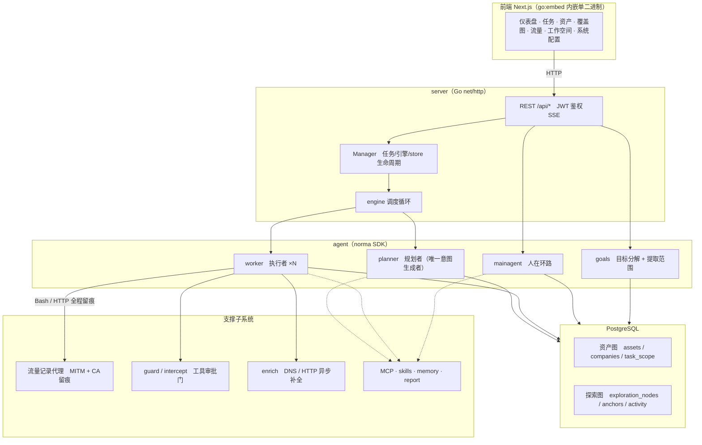

| 层 | 职责 |
| --- | --- |
| **前端** | Next.js 静态导出，`go:embed` 内嵌进单二进制；可视化任务/资产/探索链路/覆盖图，人在环路对话 |
| **server** | `net/http` 路由 + JWT 鉴权 + SSE；`Manager` 托管任务、引擎、DB store 的生命周期 |
| **engine** | 每任务一个 `plannerLoop` + N 个 worker goroutine；意图领取、超时/暂停/drain |
| **agent** | goals / planner / worker / mainagent，`ToolSet` 把双图暴露成 LLM 工具 |
| **db** | 双图的 Postgres 落地（pgx）；schema 随 `go:embed` 每次启动幂等建表 |
| **支撑** | 记录型 MITM 代理、审批门、异步补全、MCP/技能/记忆/报告 |

### 双图架构：探索图 + 资产图

系统把「**目标是什么**」和「**测到了什么程度**」拆成两张相互独立、又通过锚点相连的图：

- **资产图（Asset Graph，全局共享）**：跨任务同一份的资产真值库。节点为 `root_domain / subdomain / ip / service / app / endpoint`，归属公司；域名→子域→服务→端点的父子关系与去重 key 全部由程序计算，agent 只提交原始信息。
- **探索图（Exploration Graph，每任务独立）**：一次任务的“思考与推进”过程。节点为 `goal（目标）/ intent（意图）/ fact（事实）/ finding（漏洞）/ hint（提示）`，靠 `spawns / derived_from / yields / proves` 等边连成**血缘链**，回答“哪个方向派生自哪些事实、产出了什么”。
- **两图靠锚点相连**：`exploration_anchors(node_id, asset_id)` 把意图/事实/漏洞锚定到具体资产上——于是既能从“探索方向”看它打的是哪些资产，也能从“某个资产”反查它在本任务被哪些意图测过、得出过哪些事实。这也支撑了**资产测试覆盖度**与**资产覆盖图**（范围内资产 + 已测高亮）。

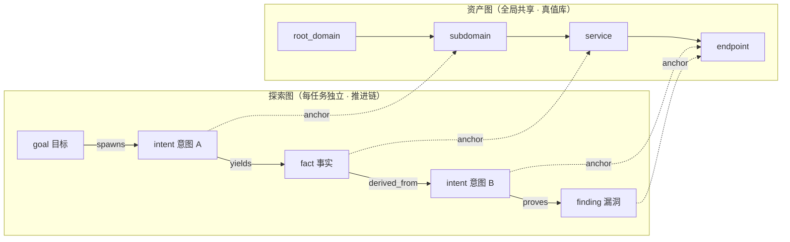

> 分工：**planner** 读探索图态势、判目标、只在有未覆盖的新方向时派**意图**进 frontier；**worker** 领**一条意图**、用真实工具执行、把新资产/事实/漏洞写回两图后即停。资产图是共享事实，探索图是每任务的推进链。

### 引擎与意图生命周期（一次探索的闭环）

引擎是**事件驱动**的闭环：图一变就唤醒 planner，planner 派意图，worker 领意图执行并写回，写回又触发下一轮——直到目标被证明（`prove_goal`）。

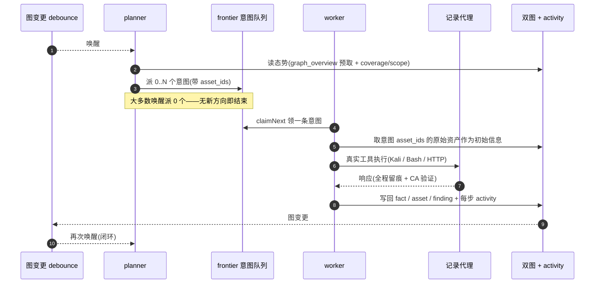

### worker 间的过程级信息交换

一次深入的探索里，很多有价值的观察（某个报错、某段响应、某个隐藏参数）出现在一个 worker 的**执行过程**中，却未必被写成正式 fact。为避免重复劳动、让链路上的 worker 能站在彼此的肩膀上，worker 具备**跨 work 检索过程**的能力：

- `search_all_worker_traces(q)`：在**本任务其他 work 的执行过程**里按关键字检索（自动排除自己这条意图的步骤），命中项带 `intent_id`；
- `list_worker_traces` / `get_worker_trace(intent_id, step_ids=[…])`：先看有哪些 work 跑过，再取某个 work 具体几步的完整内容做细节交换。

这样即便探索图上还没有对应的 fact，后续 worker 也能复用他人过程中的观察——**信息在 worker 之间以“执行过程”为粒度流动**，而边界不变（每个 worker 仍只做自己领到的那条意图）。

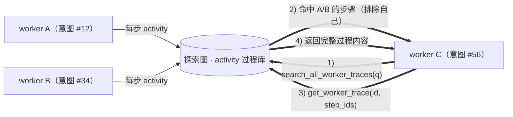

### planner 多轮共享 todolist → 稳定的攻击链路

真实攻击链往往是**有前后依赖的多步序列**（如：发现注入点 → 拿到凭据 → 横向 → 提权），一次性把这些并行派下去只会乱套。planner 因此持有一份**按任务保留、跨唤醒共享的规划待办（todolist）**：

- planner 是事件驱动的——图一变就被唤醒，但**每次唤醒是全新会话**；共享的 todolist 让它把一条串行利用链**记录一次**、然后在后续多轮里**按依赖逐步派意图**，而不是把整条链在一轮里全部前置展开；
- 每轮只对「前置步骤已完成、其依赖的 fact 已存在」的下一步派意图，并随进展更新清单（把已被 fact 满足的步骤标完成）。

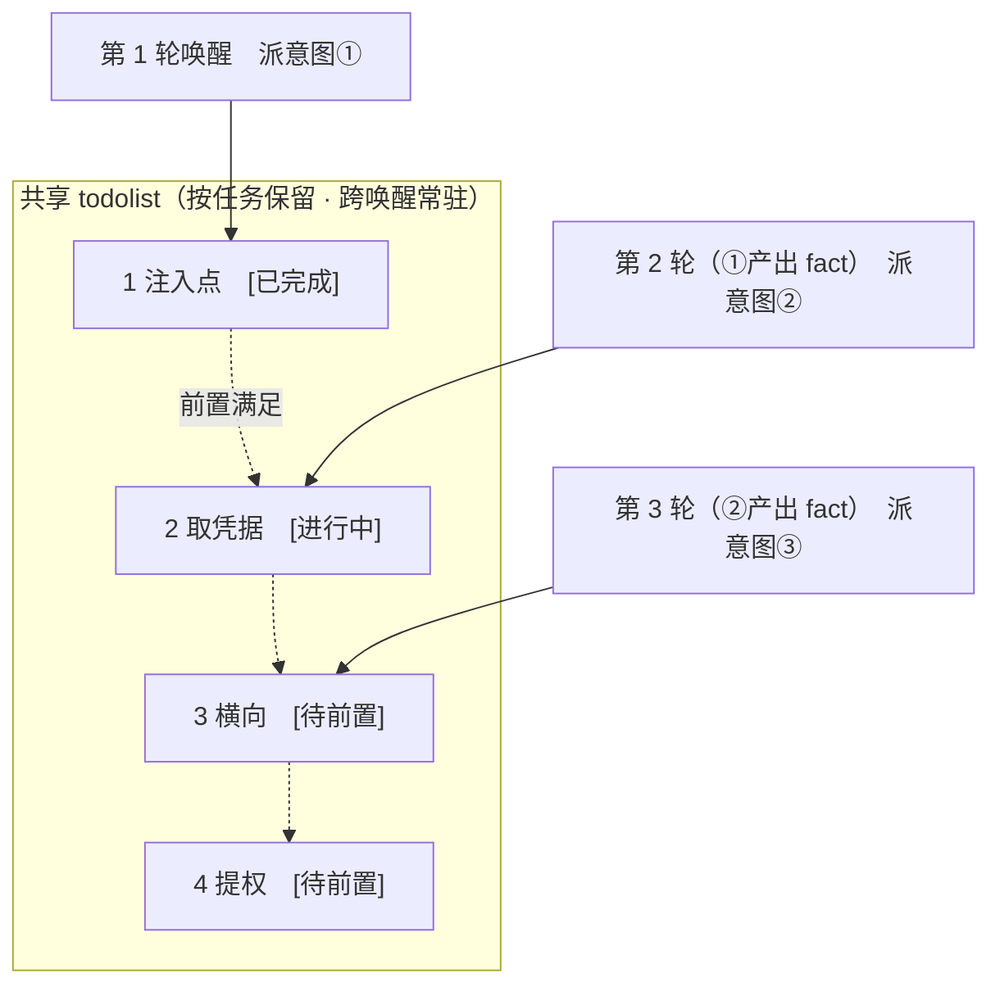

于是攻击链在“事件驱动 + 无状态会话”的环境下依然**稳定推进、不重复、不错序**——这是 ARTEX 能自主走完多步利用链的关键。

---

## 联系我们

扫码关注微信公众号 **知白守黑1024**，后台私信即可交流。

<div align="center">


</div>

---
## 参考

https://github.com/oritera/Cairn


## 许可与免责声明

### 开源协议

本项目采用 **GNU Affero General Public License v3.0（AGPL-3.0）** 授权，完整条款见仓库根目录的 [LICENSE](LICENSE) 文件。

本仓库是上游 ARTEX 的二次开发分支；原始代码版权归 Autumn-27 及贡献者所有，本分支的修改同样以 AGPL-3.0 发布。

这意味着任何人都可以自由使用、修改和分发本项目，但**衍生作品必须同样以 AGPL-3.0 开源**；特别地，**若你修改本项目并通过网络（如部署为在线服务）向用户提供，也必须向这些用户公开对应的完整源码**。

> ⚠️ **重要提示**：开源协议本身不限制软件的使用用途。以下的「使用限制」与「免责声明」是作者对使用者的额外约定与郑重声明，请务必遵守。

**ARTEX 仅供个人学习、代码研究与本地技术验证使用，不得用于对任何线上系统或网站发起实际测试。**

### 允许使用范围

- 仅可用于**阅读、学习与研究本项目源码**，以及在**本地隔离环境**中进行技术原理验证；
- 适用于个人学习、学术研究、代码审阅等非攻击性用途。

### 禁止事项

- **严禁使用本工具对任何网站、线上服务或联网系统发起扫描、探测、利用或攻击**（无论是否获得授权、是否为自有资产）；
- 严禁将本工具用于任何实际的渗透测试、攻防对抗或生产环境；
- 严禁将本工具用于非法入侵、数据窃取、勒索、拒绝服务或任何破坏性、犯罪性活动；
- 严禁利用本工具从事违反所在国家/地区法律法规的行为。

### 合规责任

使用者须自行遵守所在国家/地区关于网络安全、数据保护与计算机犯罪的全部法律法规（在中国大陆包括但不限于《网络安全法》《数据安全法》《个人信息保护法》及相关司法解释）。**因使用本工具产生的一切法律责任与后果，均由使用者自行承担。**

### 免责声明

本项目按“现状（AS IS）”提供，不附带任何明示或默示的担保。作者及贡献者不对使用本工具（无论使用方式是否得当）所导致的任何直接或间接损失、数据丢失、系统损坏或法律纠纷承担责任。**下载、安装或使用本项目，即表示你已阅读、理解并同意上述全部条款。**
